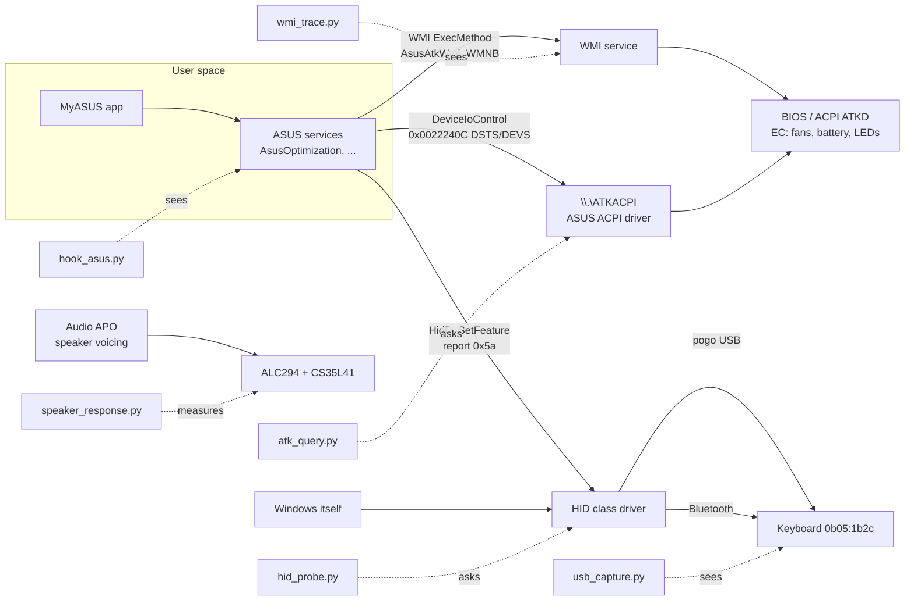

# Studying the ASUS software from Windows

The fastest way to make Linux behave like Windows on this laptop is to watch
what the ASUS software does on Windows and copy it. `windows/` is a small kit
for that. You run it on the Windows partition while flipping MyASUS settings
and pressing keys. It writes logs that are decoded on either OS into "this
setting sent these bytes to this device". The Linux side then sends the same
bytes.

**Status, read first.** The decoders are tested (`tests/test_windows_re.py`).
The capture scripts have **not been run on Windows yet**: they were written
against the documented APIs, with no machine to try them on. Expect the first
run of each to need a fix. Every place where the kit or this guide relies on
a guess is marked **GUESS** below with a rough confidence, and the
[Gaps](#gaps-and-guesswork) section collects them.

## What talks to the hardware on Windows



On Linux, two channels cover almost everything here. The ATK calls are what
`asus-wmi` already makes: the same DSTS/DEVS methods and the same device ids,
and debugfs can replay them. The keyboard's feature reports are what
`lib/kb_init.py` and `lib/kb_backlight.py` send over hidraw. So the job is
mostly to find which device id and which value, or which bytes.

## Rules

- **Never accept a firmware update while capturing**, and never from these
  tools. MyASUS offers keyboard and BIOS updates. Decline them, or close the
  app before you start. This is the project's no-flashing rule (CLAUDE.md).
- Everything is read only except two commands: `hid_probe.py send`, which
  needs `--yes` and only allows report ids 0x5a/0x5d/0x5e, and the Linux
  debugfs replays that `analyze.py` prints. Run those by hand, one at a
  time, and only once you know what the device id is.
- Change **one** thing per marker, then undo it in the next one. The guided
  scenarios are written that way.
- When a capture settles a question, write the finding into
  `docs/HARDWARE.md` as "measured (date), Windows capture". Delete the
  matching **VERIFY-ON-HW**, and attach the session folder to an issue or a
  PR. `windows/captures/` is git-ignored.
- Legal: decompiling ASUS binaries probably breaks the MyASUS EULA. Watching
  what your own machine sends to its own hardware is a different activity,
  and that is all this kit does. Interoperability exceptions exist in some
  jurisdictions (for example EU Directive 2009/24/EC, Art. 6), but this is
  not legal advice.

## Setup (Windows, once)

1. Install Python 3.11 or newer from https://www.python.org/downloads/windows/.
   Tick "py launcher".
2. Get this repository on the Windows side, either with a git clone or a ZIP
   from GitHub. All commands below run from its `windows\` folder in an
   **Administrator** PowerShell. The ASUS services run as SYSTEM, and the
   capture drivers need admin rights. Run every script with `py`, the
   interpreter `pip` installed into. The scripts carry no `#!` line on
   purpose: `py` follows one, and `#!/usr/bin/env python3` sent it to a
   different Python on PATH, one without Frida (seen 2026-10-30).
3. Install the extras that only some tools need:

```powershell
py -m pip install frida numpy sounddevice
```

4. Wireshark, with USBPcap: download the Windows x64 installer from
   https://www.wireshark.org/download.html and run it. On the component
   page, **tick "USBPcap"**. It is unticked by default, and
   `usb_capture.py` needs it. Npcap, which the installer also offers, is
   for network capture and is not needed here. Use the graphical installer:
   a silent install (`winget`, `/S`) skips USBPcap. **Reboot afterwards.**
   USBPcap's driver loads only at boot, and until then `usb_capture.py`
   finds no interfaces. Wireshark also lets you look at the captures by
   eye: the display filter `usbhid || usb.idVendor == 0x0b05` is a start,
   and `analyze.py` does the decoding.
5. Optional, for on-air Bluetooth: Microsoft's Bluetooth Test Platform
   (BTVS), https://learn.microsoft.com/windows-hardware/drivers/bluetooth/testing-btp-tools-btvs.
   **GUESS, about 65 %** that it works with the Duo's Intel radio without a
   separate sniffer. `hook_asus.py` covers Bluetooth commands without it.

Before any run, turn Windows Fast Startup off if you have not already:
`powercfg /h off`. The reason is unrelated to the kit: see docs/HARDWARE.md,
"The PUP_DONE failure".

## The tools

| Script | Answers | Changes anything? |
|---|---|---|
| `inventory.py` | Which ASUS services, drivers, packages, WMI classes and audio effects are installed, with versions and SHA-256 hashes | No |
| `hook_asus.py` | Which ATK calls and HID reports the ASUS processes make, per action | No (it injects a read-only hook) |
| `atk_query.py` | Which ATK device ids exist on this BIOS, and their current values | No (DSTS only) |
| `hid_probe.py` | The keyboard's HID collections as Windows sees them; reading report 0x5a; listening to vendor input | `send` only, guarded |
| `usb_capture.py` | What actually crosses the pogo USB link, including Windows' own traffic on attach, and STALLs | No |
| `wmi_trace.py` | Which WMI methods are called, for the calls that bypass the processes | Enables and disables one Windows log |
| `snapshot.py` | Where MyASUS stores a setting, and the values it takes | No |
| `speaker_response.py` | The speaker curve under Windows (and Linux), for fitting `lib/speaker_dsp.py` | No |
| `analyze.py` | Merges everything into one timeline per marker, with Linux replays | No; runs on either OS |

Each interactive tool takes `--scenario NAME` (`attach`, `keyboard`, `power`,
`display`, `audio`; the steps are in `windows/zenduo_re.py`). It prints one
step at a time. Press Enter *just before* you do the step, which writes a
timestamped marker. Without `--scenario`, type your own label and press
Enter. Type `q` to stop.

## Recipes

### 0. Inventory (once per Windows or MyASUS version)

```powershell
py inventory.py
```

Start with `services.json`, `drivers.json` and `wmi_classes.json`. If
`wmi_classes.json` lists `AsusAtkWmi_WMNB` with `DEVS` and `DSTS` methods,
the WMI route exists. `apo_clsids.json` and `audio_effects.json` name the
speaker APO's vendor. `files.json` is the list to give a disassembler when a
capture leaves a question open (see [Static analysis](#static-analysis-when-captures-are-not-enough)).

### 1. Keyboard: handshake, backlight, Fn-lock, unknown keys

Run three tools at once, each in its own Administrator window. Start them in
this order and stop them in reverse:

```powershell
py usb_capture.py
```

```powershell
py hid_probe.py listen
```

```powershell
py hook_asus.py --scenario keyboard
```

Walk the scenario in the `hook_asus` window. Then repeat with the keyboard
**detached and paired over Bluetooth**, without `usb_capture.py`: use
`hook_asus.py` and `hid_probe.py listen` only.

Questions this answers:

- Does Windows (or MyASUS) send the `ASUS Tech.Inc.` handshake, on which
  report ids, and the four OOBE reports that `kb_init.py` sends on a guess?
  Use the `attach` scenario for this one.
- Is the backlight command the same `5a ba c5 c4 <level>` over Bluetooth? If
  Windows sends something else there, that explains the Bluetooth refusals
  in HARDWARE.md.
- Is the backlight timeout a host timer (a write of level 0 after the idle
  time shows up) or keyboard firmware (no write)?
- Does Fn-lock go to the keyboard (a HID report) or to the BIOS (`ATK DEVS
  0x00100023 FNLOCK`)?
- Which keys send `7c`, `7e` and `86`, and what changes in `5a 3d xx yy`?
  Note the keyboard battery percentage that Windows shows (Settings >
  Bluetooth) when a `3d` arrives. **GUESS, about 40 %**: the third byte is a
  battery or charging state.

After a MyASUS keyboard action, this reads back the last 0x5a command:

```powershell
py hid_probe.py read-feature 5a
```

**GUESS**: this works only if the read-back buffer behaves as it does on
Linux.

### 2. Fan profile, battery limit, other BIOS settings

```powershell
py atk_query.py --json before.json
```

Then change one setting in MyASUS (for example, fan profile to Whisper) and
run:

```powershell
py atk_query.py --json after.json
```

```powershell
py analyze.py atk-diff before.json after.json
```

That names the device id and both values, which is often enough on its own.
To see the calls themselves, and whether they go through ATKACPI or WMI:

```powershell
py hook_asus.py --scenario power
```

```powershell
py wmi_trace.py --scenario power
```

Run the two in separate windows, both walking the same steps. `analyze.py`
prints the Linux replay for every DEVS call. On Ubuntu:

```bash
echo 0x00110019 | sudo tee /sys/kernel/debug/asus-nb-wmi/dev_id
echo 0x00000001 | sudo tee /sys/kernel/debug/asus-nb-wmi/ctrl_param
sudo cat /sys/kernel/debug/asus-nb-wmi/devs
```

(The values are an example.) If Linux already has a knob for that id, use the
knob in the project's code, not debugfs. For example, `platform_profile` for
the thermal policy, or `charge_control_end_threshold` for RSOC. The capture
then only tells you which MyASUS name maps to which value. **Watch the
order**: asus-wmi maps the Vivobook/Zenbook thermal ids in a different order
from the ROG ones (read in drivers/platform/x86/asus-wmi.c).

"Memory Allocated to GPU" (Power & Performance) is not in the `power`
scenario, because it only takes effect after a restart. To capture it, run
`atk_query.py --json before.json`, change the setting, restart, then run
`atk_query.py --json after.json` and diff the two. **GUESS, about 60 %**:
it is the `APU_MEM` id, `0x000600c1`, which asus-wmi already knows.

To find ids that nobody has named:

```powershell
py atk_query.py --range 0x00120000 0x001200ff
```

### 3. Where a setting lives

```powershell
py snapshot.py take before
```

Change one MyASUS setting, then:

```powershell
py snapshot.py take after
```

```powershell
py snapshot.py diff before after
```

This gives the setting's name and its range of values. Use it to label the
Linux option the same way.

### 4. Speakers

Measure each OS in its normal state. On Windows that means the default sound
mode. On Ubuntu, measure once with the EasyEffects chain bypassed and once
with it on. Use the same volume, lid angle and microphone position each time.

Windows:

```powershell
py speaker_response.py measure --label windows-default
```

Ubuntu:

```bash
python3 windows/speaker_response.py measure --label linux-bypassed
```

```bash
python3 windows/speaker_response.py compare windows-default linux-bypassed
```

The difference at each level is an estimate of the Windows APO's curve,
taken relative to the 630 Hz band, as in `nix/audio.nix`. On Windows, turn
off "Audio enhancements" and AI noise cancelation for the **microphone**
first. A USB measurement microphone (pass it with `--input`) makes the
result worth much more than the internal DMIC does.

### 5. Read it all on Linux

Copy `windows\captures\` to the Ubuntu side (USB stick, cloud folder), then:

```bash
python3 windows/analyze.py --quiet-opens windows/captures/*-hooks windows/captures/*-usb windows/captures/*-hid-listen
```

Use `--json timeline.json` to get a machine-readable copy for an issue.

## Gaps and guesswork

What is known, what the kit assumes, and how sure that is.

| # | Topic | Status today | How the kit settles it | Residual gap |
|---|---|---|---|---|
| 1 | Keyboard handshake on attach | Linux copies hid-asus and **guesses** the OOBE sequence (`kb_init.py`) | `usb_capture` + `hook_asus`, `attach` | None if the capture is clean |
| 2 | Backlight over Bluetooth | Same bytes as USB, refusals logged (HARDWARE.md) | `hook_asus` detached | On-air answers need BTVS |
| 3 | Backlight idle timeout | Linux does it in `watch-fn` | `hook_asus`, keyboard scenario | None |
| 4 | Fn-lock | Code `4e` seen, state not set (PLAN Q) | `hook_asus` + `atk_query` diff | If it is keyboard firmware alone, nothing to send |
| 5 | Codes `7c`, `7e`, `86`, `3d` | Mapped from hid-asus, unconfirmed | `hid_probe listen` + scenario | Meaning of `3d`'s bytes: **GUESS** |
| 6 | Fan profiles | `platform_profile` present, unwired (PLAN T) | `atk_query` diff, `hook_asus` | Fan curves set by a driver straight to the EC are invisible: see below |
| 7 | Battery modes | `charge_control_end_threshold` works | `atk_query` diff | Whether MyASUS re-sends at each boot (hooks attach too late to see it) |
| 8 | Speaker voicing | Fitted by ear and DMIC shape (`speaker_dsp.py`) | `speaker_response` | Mic colour; APO is level-dependent, so the curve is a slice |
| 9 | Splendid / OLED care / colour | Not attempted | `snapshot` names the settings | Probably GPU gamma/ICC and UI behaviour, not hardware calls; reproduce by observation |
| 10 | Mic noise cancelation | Not attempted (PLAN S) | `inventory` names the APO | A neural APO cannot be copied; use a Linux suppressor |

Assumptions inside the kit:

- **MyASUS uses `\\.\ATKACPI` with IOCTL 0x0022240C.** Read from G-Helper's
  `AsusACPI.cs` (read only). That a Zenbook's MyASUS does the same is a
  **GUESS, about 75 %**. If `hook_asus` sees no ATK calls while settings
  change, the route is WMI (`wmi_trace`) or a kernel driver.
- **WMI arguments.** The WMI-Activity log names the method. **GUESS, about
  60 %** that it does not include the arguments. In that case the
  `atk_query` before/after diff supplies them.
- **Kernel-mode blind spot.** If an ASUS driver writes EC registers directly
  (plausible for fan curves), no user-space tool sees it. The read-only way
  in is from Linux: the ACPI tables (`sudo acpidump` + `iasl -d` show what
  each ATK method does to the EC) and an EC register dump before and after.
  To read the EC, load `ec_sys` without `write_support` and read
  `/sys/kernel/debug/ec/ec0/io` in each state.
- **Frida and the ASUS services.** Attaching to a SYSTEM service from an
  admin shell normally works. A protected (PPL) process cannot be attached
  to; the tool logs that and goes on. Handles opened before the hook arrived
  show as "unknown" unless they are HID. To catch a service's start-up,
  restart the service while `hook_asus.py` runs (the rescan picks it up in
  5 s), but the first calls can still be missed.
- **Overlapped I/O.** If a process calls DeviceIoControl asynchronously, the
  hook logs the input but not the output.
- **USBPcap.** The flags `-d -o -A --inject-descriptors` come from its
  `--help` (1.5.4) and are not tried on this machine. Which root hub carries
  the pogo keyboard is not known, so the tool records all of them.
- **MyASUS paths.** The package family `B9ECED6F.ASUSPCAssistant` and the
  service names in `snapshot.py`. **GUESS, about 80 %**. `inventory.py`
  prints the real ones; correct the lists if they differ.
- **Clock alignment.** All tools stamp with the same Windows clock, so
  merging is exact. Linux and Windows measurements are never merged, only
  compared.

## Static analysis when captures are not enough

When a capture shows bytes but not *why*, read the code that sent them. Two
examples: a value computed from a table, or a command that is sent only
under some condition. `inventory.py`'s `files.json` lists the binaries with
their hashes. Ghidra (https://ghidra-sre.org/) reads the native DLLs and
services. For the .NET parts, ILSpy (https://github.com/icsharpcode/ILSpy)
gives near-source. REA (https://github.com/morluto/rea) can drive Ghidra
and inspect .NET from an AI agent, and it analyses pcaps on Linux. Its
Windows support is marked experimental, so use it for this follow-up step,
not for the captures. Keep what you learn as facts (ids, bytes, orders) in
HARDWARE.md, never as copied code.
