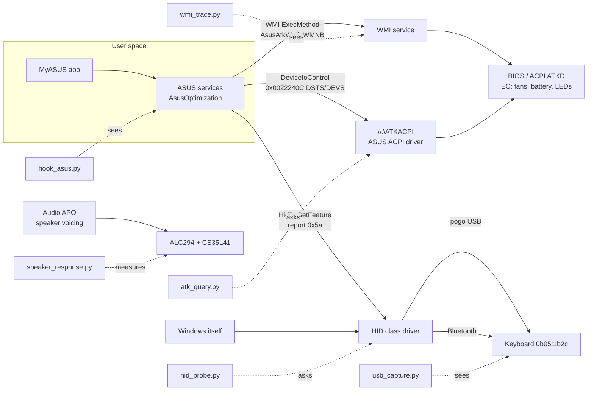

# Studying the ASUS software from Windows

The fastest way to make Linux behave like Windows on this laptop is to watch
what the ASUS software does on Windows and copy it. `windows/` is a small kit
for that. You run it on the Windows partition while flipping MyASUS settings
and pressing keys. It writes logs that are decoded on either OS into "this
setting sent these bytes to this device". The Linux side then sends the same
bytes.

**Status, read first.** The decoders are tested (`tests/test_windows_re.py`).
The capture scripts have **not been run on Windows yet**: they were written
against the documented APIs, with no machine to try them on. Expect the first
run of each to need a fix. Every place where the kit or this guide relies on
a guess is marked **GUESS** below with a rough confidence, and the
[Gaps](#gaps-and-guesswork) section collects them.

## What talks to the hardware on Windows



On Linux, two channels cover almost everything here. The ATK calls are what
`asus-wmi` already makes: the same DSTS/DEVS methods and the same device ids,
and debugfs can replay them. The keyboard's feature reports are what
`lib/kb_init.py` and `lib/kb_backlight.py` send over hidraw. So the job is
mostly to find which device id and which value, or which bytes.

## Rules

- **Never accept a firmware update while capturing**, and never from these
  tools. MyASUS offers keyboard and BIOS updates. Decline them, or close the
  app before you start. This is the project's no-flashing rule (CLAUDE.md).
- Everything is read only except two commands: `hid_probe.py send`, which
  needs `--yes` and only allows report ids 0x5a/0x5d/0x5e, and the Linux
  debugfs replays that `analyze.py` prints. Run those by hand, one at a
  time, and only once you know what the device id is.
- Change **one** thing per marker, then undo it in the next one. The guided
  scenarios are written that way.
- When a capture settles a question, write the finding into
  `docs/HARDWARE.md` as "measured (date), Windows capture". Delete the
  matching **VERIFY-ON-HW**, and attach the session folder to an issue or a
  PR. `windows/captures/` is git-ignored.
- Legal: decompiling ASUS binaries probably breaks the MyASUS EULA. Watching
  what your own machine sends to its own hardware is a different activity,
  and that is all this kit does. Interoperability exceptions exist in some
  jurisdictions (for example EU Directive 2009/24/EC, Art. 6), but this is
  not legal advice.

## Setup (Windows, once)

1. Install Python 3.11 or newer from https://www.python.org/downloads/windows/.
   Tick "py launcher".
2. Get this repository on the Windows side, either with a git clone or a ZIP
   from GitHub. All commands below run from its `windows\` folder in an
   **Administrator** PowerShell. The ASUS services run as SYSTEM, and the
   capture drivers need admin rights. Run every script with `py`, the
   interpreter `pip` installed into. The scripts carry no `#!` line on
   purpose: `py` follows one, and `#!/usr/bin/env python3` sent it to a
   different Python on PATH, one without Frida (seen 2026-10-30).
3. Install the extras that only some tools need:

```powershell
py -m pip install frida numpy sounddevice
```

4. Wireshark, with USBPcap: download the Windows x64 installer from
   https://www.wireshark.org/download.html and run it. On the component
   page, **tick "USBPcap"**. It is unticked by default, and
   `usb_capture.py` needs it. Npcap, which the installer also offers, is
   for network capture and is not needed here. Use the graphical installer:
   a silent install (`winget`, `/S`) skips USBPcap. **Reboot afterwards.**
   USBPcap's driver loads only at boot, and until then `usb_capture.py`
   finds no interfaces. Wireshark also lets you look at the captures by
   eye: the display filter `usbhid || usb.idVendor == 0x0b05` is a start,
   and `analyze.py` does the decoding.
5. Optional, for on-air Bluetooth: Microsoft's Bluetooth Test Platform
   (BTVS), https://learn.microsoft.com/windows-hardware/drivers/bluetooth/testing-btp-tools-btvs.
   **GUESS, about 65 %** that it works with the Duo's Intel radio without a
   separate sniffer. `hook_asus.py` covers Bluetooth commands without it.

Before any run, turn Windows Fast Startup off if you have not already:
`powercfg /h off`. The reason is unrelated to the kit: see docs/HARDWARE.md,
"The PUP_DONE failure".

## The tools

| Script | Answers | Changes anything? |
|---|---|---|
| `capture.py` | Runs the hooks, HID listener, USB capture and WMI trace together in one window, walks a scenario, and reads the BIOS settings after each step: the one to use for recipes 1 and 2 | Enables and disables one Windows log |
| `inventory.py` | Which ASUS services, drivers, packages, WMI classes and audio effects are installed, with versions and SHA-256 hashes | No |
| `hook_asus.py` | Which ATK calls and HID reports the ASUS processes make, per action | No (it injects a read-only hook) |
| `atk_query.py` | Which ATK device ids exist on this BIOS, and their current values; `--save`/`--compare` for a change across a restart | No (DSTS only) |
| `hid_probe.py` | The keyboard's HID collections as Windows sees them; reading report 0x5a; listening to vendor input | `send` only, guarded |
| `usb_capture.py` | What actually crosses the pogo USB link, including Windows' own traffic on attach, and STALLs | No |
| `wmi_trace.py` | Which WMI methods are called, for the calls that bypass the processes | Enables and disables one Windows log |
| `snapshot.py` | Where MyASUS stores a setting, and the values it takes | No |
| `speaker_response.py` | The speaker curve under Windows (and Linux), for fitting `lib/speaker_dsp.py` | No |
| `analyze.py` | Merges everything into one timeline per marker, with Linux replays | No; runs on either OS |

Each interactive tool takes `--scenario NAME`: `keyboard-docked`,
`keyboard-bluetooth`, `attach`, `power`, `display` or `audio`
(`py capture.py --list-scenarios`; the steps are in `windows/zenduo_re.py`).
It shows one step at a time in colour: a yellow `STEP n/N` bar, the action
in cyan, a grey hint under it. Each step is one key press or one click, and
says how many presses are left, for example "(backlight 2 of 4)".

- **An action step** is marked the moment it appears. Do it, then press
  Enter.
- **A keyboard step** ("Put the keyboard on the lower screen", "Wait for the
  keyboard to connect over Bluetooth") ends by itself once Windows sees the
  keyboard that way. Press Enter if it does not notice.
- **A hands-off step** counts down by itself. Touch nothing until it ends.

`s` skips a step, `r` goes back and does the step before again (for
example when a click went to the wrong switch), and `q` stops. After the last
step, `r` redoes that one, and Enter finishes. After each step a green line says what was
caught during it, for example `✓ caught: 1 HID write, 2 keyboard reports`.
"caught: nothing" on a step that should have done something is worth a note
in the issue. Every event goes to `events.log` in the session folder, not to
the screen. To watch it live, run this in a second window:

```powershell
Get-Content captures\<session>\events.log -Wait
```

To run some steps again later, list the numbers, then pick them with
`--steps`:

```powershell
py capture.py --scenario power --list-steps
```

```powershell
py capture.py --scenario power --steps 4-6
```

`--steps` takes one number (`5`), a list and ranges (`5-7,12`), or a start
to the end (`20-`). Each run is its own session folder, so send its
`timeline.txt` with the first one. Over a keyboard scenario, the steps still
check that the keyboard is in the right place first.

Without `--scenario`, type your own label and press Enter.

## Recipes

### 0. Inventory (once per Windows or MyASUS version)

```powershell
py inventory.py
```

Start with `services.json`, `drivers.json` and `wmi_classes.json`. If
`wmi_classes.json` lists `AsusAtkWmi_WMNB` with `DEVS` and `DSTS` methods,
the WMI route exists. `apo_clsids.json` and `audio_effects.json` name the
speaker APO's vendor. `files.json` is the list to give a disassembler when a
capture leaves a question open (see [Static analysis](#static-analysis-when-captures-are-not-enough)).

### 1. Keyboard: handshake, backlight, Fn-lock, unknown keys

The keyboard is captured **twice**, once in each position, because the two
links behave differently (docs/HARDWARE.md). Each run is one command in one
Administrator window.

**Run 1, keyboard docked** (on the lower screen, on its pins: USB):

```powershell
py capture.py --scenario keyboard-docked
```

**Run 2, keyboard detached** (off the screen, on the desk: Bluetooth):

```powershell
py capture.py --scenario keyboard-bluetooth
```

**The USB capture sees every key typed on the docked keyboard**, the
Enter presses for the steps included. When it stops, `capture.py` blanks
letters, digits, symbols and the keypad in the saved `.pcap` files and keeps
only shortcuts (Ctrl+Win+F24, F-keys, modifiers), and `timeline.txt` hides
typing too. Still, do not type a password during a run. Captures made
before 2026-10-31 were not blanked; run this on their folders before
sharing them:

```powershell
py analyze.py scrub captures\*
```

Before step 1, `capture.py` lists what it started: the hooks in the ASUS
processes, the HID listener, the USB capture (run 1 only) and the WMI
trace. A red ✗ line says what is missing and how to fix it. The rest still
runs. Open MyASUS before you start, or when that list asks for it.

Step 1 of each run puts the keyboard in place and waits until Windows sees
it there. Every later step checks again. If the keyboard moves mid-run, for
example if it slips off the pins, the step holds until it is back. The
check reads the keyboard's ids (`0b05:1b2c` on USB, `0b05:1b2d` on
Bluetooth) from Windows' device list (measured 2026-10-31: it saw both
positions correctly). If a keyboard step never ends although the keyboard is in
place, press Enter, and mention it in the issue.
Over Bluetooth there is no USB capture, because nothing crosses the pins.
Bluetooth commands are covered by the hooks, since they go through the same
`HidD_*` calls.

The older per-tool commands (`hook_asus.py`, `hid_probe.py listen`,
`usb_capture.py`) still work alone with the same `--scenario` names. They
are for when one part misbehaves.

Questions this answers:

- Does Windows (or MyASUS) send the `ASUS Tech.Inc.` handshake, on which
  report ids, and the four OOBE reports that `kb_init.py` sends on a guess?
  Use the `attach` scenario for this one (`py capture.py --scenario attach`).
- Is the backlight command the same `5a ba c5 c4 <level>` over Bluetooth? If
  Windows sends something else there, that explains the Bluetooth refusals
  in HARDWARE.md.
- Is the backlight timeout a host timer (a write of level 0 after the idle
  time shows up) or keyboard firmware (no write)?
- Does Fn-lock go to the keyboard (a HID report) or to the BIOS (`ATK DEVS
  0x00100023 FNLOCK`)?
- Which keys send `7c`, `7e` and `86`, and what changes in `5a 3d xx yy`?
  Note the keyboard battery percentage that Windows shows (Settings >
  Bluetooth) when a `3d` arrives. **GUESS, about 40 %**: the third byte is a
  battery or charging state.

After a MyASUS keyboard action, this reads back the last 0x5a command:

```powershell
py hid_probe.py read-feature 5a
```

**GUESS**: this works only if the read-back buffer behaves as it does on
Linux.

### 2. Fan profile, battery limit, other BIOS settings

One run of `capture.py` covers this. After every step it reads the BIOS
settings again and names the one that step changed, so there is nothing to
compare by hand.

1. Plug the charger in. Performance mode is only offered on the charger.
2. Open MyASUS.
3. In an Administrator PowerShell, in the `windows\` folder, run:

   ```powershell
   py capture.py --scenario power
   ```

4. Check the list it prints before step 1. The line `BIOS read: … settings
   read after every step` must have a green ✓. A red ✗ there usually means
   the window is not an Administrator one.
5. Press Enter to start, then follow the steps on screen (18 of them, about
   5 minutes). Each one is a single click in MyASUS or Windows Settings, or
   one Fn+F press.
6. After a step that changed a BIOS setting, a cyan line appears under the
   green one, for example (the values here are made up):

   ```
   ✓ caught: 2 ATK calls
     BIOS changed: THROTTLE_THERMAL_POLICY (0x00120075): 0x00010000 -> 0x00010001
   ```

   A step without that line changed nothing the BIOS reports. That is
   expected for the Windows power-mode steps, and worth noting for any
   MyASUS one.
7. When the last step is done, send `timeline.txt` from the session folder
   that it names. That file holds every step's calls, the BIOS changes, and
   the matching Linux commands.

**Memory Allocated to GPU** takes effect only after a restart, so it cannot
be a step: the capture would stop at the restart. Do it by hand:

1. In an Administrator PowerShell, in `windows\`, run:

   ```powershell
   py atk_query.py --range 0x00060000 0x000600ff --save before-gpu
   ```

   The range reads every id in that block the BIOS answers for, so the
   guess below does not need to be right. (A first try without it,
   2026-10-31, read only the named ids and saw nothing.)

2. In MyASUS > Device Settings > Power & Performance > Memory Allocated to
   GPU, pick a different amount. Note the old one.
3. Restart Windows when MyASUS asks.
4. After the restart, in an Administrator PowerShell, in `windows\`, run:

   ```powershell
   py atk_query.py --compare before-gpu
   ```

   It prints only the settings that changed, with old and new values.
   Send that output.
5. Put the setting back and restart again.

**GUESS, about 60 %**: the setting is the `APU_MEM` id, `0x000600c1`, which
asus-wmi already knows.

Measured 2026-10-31: on this unit the setting does not survive the restart
at all (8 GB and 1 GB both came back as "Automatic"), and no hooked ASUS
process made a BIOS call for it, so this recipe found nothing to copy. See
HARDWARE.md, "What MyASUS does".

Optional: to look for BIOS settings that nobody has named, run this once:

```powershell
py atk_query.py --range 0x00120000 0x001200ff
```

It lists every id in that range the BIOS answers for.

#### On the Linux side (not part of the capture)

`timeline.txt` gives the debugfs commands that repeat each call on Ubuntu,
for example:

```bash
echo 0x00110019 | sudo tee /sys/kernel/debug/asus-nb-wmi/dev_id
echo 0x00000001 | sudo tee /sys/kernel/debug/asus-nb-wmi/ctrl_param
sudo cat /sys/kernel/debug/asus-nb-wmi/devs
```

(The values are an example.) If Linux already has a knob for that id, use the
knob in the project's code, not debugfs. For example, `platform_profile` for
the thermal policy, or `charge_control_end_threshold` for RSOC. The capture
then only tells you which MyASUS name maps to which value. **Watch the
order**: asus-wmi maps the Vivobook/Zenbook thermal ids in a different order
from the ROG ones (read in drivers/platform/x86/asus-wmi.c).

### 3. Where a setting lives

```powershell
py snapshot.py take before
```

Change one MyASUS setting, then:

```powershell
py snapshot.py take after
```

```powershell
py snapshot.py diff before after
```

This gives the setting's name and its range of values. Use it to label the
Linux option the same way.

### 4. Speakers

Measure each OS in its normal state. On Windows that means the default sound
mode. On Ubuntu, measure once with the EasyEffects chain bypassed and once
with it on. Use the same volume, lid angle and microphone position each time.

Windows:

```powershell
py speaker_response.py measure --label windows-default
```

Ubuntu:

```bash
python3 windows/speaker_response.py measure --label linux-bypassed
```

```bash
python3 windows/speaker_response.py compare windows-default linux-bypassed
```

The difference at each level is an estimate of the Windows APO's curve,
taken relative to the 630 Hz band, as in `nix/audio.nix`. On Windows, turn
off "Audio enhancements" and AI noise cancelation for the **microphone**
first. A USB measurement microphone (pass it with `--input`) makes the
result worth much more than the internal DMIC does.

### 5. Read it all on Linux

`capture.py` already writes `timeline.txt` (the `analyze.py` output) into
each session folder, on Windows. To read one or more sessions again, copy
`windows\captures\` to the Ubuntu side (USB stick, cloud folder), then:

```bash
python3 windows/analyze.py --quiet-opens windows/captures/*-capture-*
```

Folders from the single tools (`*-hooks`, `*-usb`, `*-hid-listen`, `*-wmi`)
can be given together; their events are merged by time.

Use `--json timeline.json` to get a machine-readable copy for an issue.

## Gaps and guesswork

What is known, what the kit assumes, and how sure that is.

| # | Topic | Status today | How the kit settles it | Residual gap |
|---|---|---|---|---|
| 1 | Keyboard handshake on attach | Linux copies hid-asus and **guesses** the OOBE sequence (`kb_init.py`) | `capture.py`, `attach` | None if the capture is clean |
| 2 | Backlight over Bluetooth | Windows sends the same `5a ba c5 c4` bytes over Bluetooth (measured 2026-10-31) | `capture.py`, `keyboard-bluetooth` | Whether the keyboard accepts them: on-air answers need BTVS |
| 3 | Backlight idle timeout | Linux does it in `watch-fn`; no host write seen in 90 s on Windows (2026-10-31) | `capture.py`, both keyboard scenarios (a 90 s hands-off step) | Whether the shortest MyASUS time is under 90 s |
| 4 | Fn-lock | Settled 2026-10-31: the host sends `5a d0 4e <0/1>` (HARDWARE.md) | Done | Linux has to send it (PLAN Q) |
| 5 | Codes `7c`, `7e`, `86`, `3d` | `7c` F9, `7e` F11, `86` F12, `9d` Fn+F measured 2026-10-31 | `capture.py`, both keyboard scenarios | `3d`'s third byte as battery %: about 85 % (99 % in Settings matched `5a 3d 63`, 2026-10-31); `5a 3d 05 09` on Linux unexplained |
| 6 | Fan profiles | `platform_profile` present, unwired (PLAN T) | `atk_query` diff, `hook_asus` | Fan curves set by a driver straight to the EC are invisible: see below |
| 7 | Battery modes | `charge_control_end_threshold` works | `atk_query` diff | Whether MyASUS re-sends at each boot (hooks attach too late to see it) |
| 8 | Speaker voicing | Fitted by ear and DMIC shape (`speaker_dsp.py`) | `speaker_response` | Mic colour; APO is level-dependent, so the curve is a slice |
| 9 | Splendid / OLED care / colour | Not attempted | `snapshot` names the settings | Probably GPU gamma/ICC and UI behaviour, not hardware calls; reproduce by observation |
| 10 | Mic noise cancelation | Not attempted (PLAN S) | `inventory` names the APO | A neural APO cannot be copied; use a Linux suppressor |

Assumptions inside the kit:

- **MyASUS uses `\\.\ATKACPI` with IOCTL 0x0022240C.** Read from G-Helper's
  `AsusACPI.cs` (read only). That a Zenbook's MyASUS does the same is a
  **GUESS, about 75 %**. If `hook_asus` sees no ATK calls while settings
  change, the route is WMI (`wmi_trace`) or a kernel driver.
- **WMI arguments.** The WMI-Activity log names the method. **GUESS, about
  60 %** that it does not include the arguments. In that case the
  `atk_query` before/after diff supplies them.
- **Kernel-mode blind spot.** If an ASUS driver writes EC registers directly
  (plausible for fan curves), no user-space tool sees it. The read-only way
  in is from Linux: the ACPI tables (`sudo acpidump` + `iasl -d` show what
  each ATK method does to the EC) and an EC register dump before and after.
  To read the EC, load `ec_sys` without `write_support` and read
  `/sys/kernel/debug/ec/ec0/io` in each state.
- **Frida and the ASUS services.** Attaching to a SYSTEM service from an
  admin shell normally works. A protected (PPL) process cannot be attached
  to; the tool logs that and goes on. Handles opened before the hook arrived
  show as "unknown" unless they are HID. To catch a service's start-up,
  restart the service while `hook_asus.py` runs (the rescan picks it up in
  5 s), but the first calls can still be missed.
- **Overlapped I/O.** If a process calls DeviceIoControl asynchronously, the
  hook logs the input but not the output.
- **USBPcap.** The flags `-d -o -A --inject-descriptors` come from its
  `--help` (1.5.4) and are not tried on this machine. Which root hub carries
  the pogo keyboard is not known, so the tool records all of them.
- **MyASUS paths.** The package family `B9ECED6F.ASUSPCAssistant` and the
  service names in `snapshot.py`. **GUESS, about 80 %**. `inventory.py`
  prints the real ones; correct the lists if they differ.
- **Clock alignment.** All tools stamp with the same Windows clock, so
  merging is exact. Linux and Windows measurements are never merged, only
  compared.

## Static analysis when captures are not enough

When a capture shows bytes but not *why*, read the code that sent them. Two
examples: a value computed from a table, or a command that is sent only
under some condition. `inventory.py`'s `files.json` lists the binaries with
their hashes. Ghidra (https://ghidra-sre.org/) reads the native DLLs and
services. For the .NET parts, ILSpy (https://github.com/icsharpcode/ILSpy)
gives near-source. REA (https://github.com/morluto/rea) can drive Ghidra
and inspect .NET from an AI agent, and it analyses pcaps on Linux. Its
Windows support is marked experimental, so use it for this follow-up step,
not for the captures. Keep what you learn as facts (ids, bytes, orders) in
HARDWARE.md, never as copied code.
